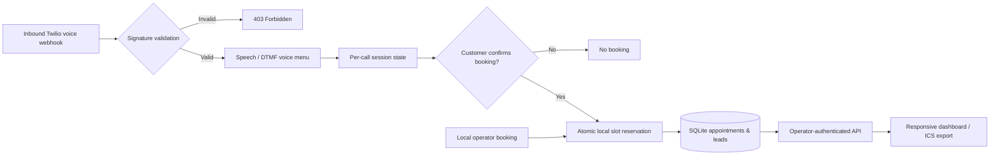

<div align="center">

# VoiceDesk Pro
### A professional receptionist prototype: appointments, incoming calls and customer follow-up.

**Voice workflow · Booking inventory · Operator dashboard · Lead capture · Auditable tests**

[](#local-setup)
[](#system-architecture)
[](#twilio-voice-adapter)
[](https://github.com/rajachanna/VoiceDesk-Pro/actions/workflows/tests.yml)
[](LICENSE)
[](#implementation-status)

**[Dashboard source](src/voicedesk/static/index.html) · [Call-flow code](src/voicedesk/voice.py) · [Tests](tests) · [Case study](docs/CASE_STUDY.md) · [Client brief](docs/CLIENT_BRIEF.md) · [Discuss integration](https://nextgentechdev.com)**

</div>

---

## The business problem

Appointment-driven businesses cannot always answer every call. A caller might need opening hours, an available consultation slot, or a way to leave a message. Doing all of this reliably requires more than a scripted welcome: the system must validate provider callbacks, avoid double-booking, request explicit booking confirmation and protect customer information.

**VoiceDesk Pro** is an open-source engineering showcase for that workflow, with a real Twilio Programmable Voice webhook integration *code path*, a transactional local scheduler and an operator dashboard.

**The current release is a prototype**: it does **not** have a connected phone number, independently verified live Twilio calls, external calendar or CRM sync, production uptime, autonomous appointment booking by an LLM or multilingual production support.

## What is implemented

| Component | v0.1 behavior | Value to review |
| --- | --- | --- |
| Signed Twilio inbound voice adapter | Verifies X-Twilio-Signature using a configured HTTPS public origin | Rejects forged or modified callbacks |
| IVR voice menu | DTMF choices for opening hours, booking, leaving a message | Clear, inspectable voice workflow |
| Speech-recognized name and message | Uses Twilio `<Gather input="speech">` and speech transcripts | Demonstrates caller data capture |
| Appointment booking | 30-minute weekdays 9 AM–5 PM, local IANA timezone, explicit confirmation | Atomic SQLite conflict checks |
| Call state | Per-CallSid session, duplicate callback protection | Avoids repeatedly booking from one phone call |
| Lead mini-CRM | Local phone/message records, operator-only access | Follow-up workflow prototype |
| Dashboard | Responsive appointments, slot picker, local lead table and metrics | Client can inspect the code and run it locally |
| Calendar interoperability | Downloadable **ICS file** | Imported calendar events, not Google Calendar two-way integration |
| FAQ | Cautious rule-based responder, **optional** OpenAI FAQ-only adapter | Won't invent missing prices or autonomously book |
| Automated tests | Signed webhook mocks, booking conflicts, call-state and auth tests | Reproducible technical evidence |

**No real calls or real calendar updates are claimed.** Both Twilio and the optional AI FAQ require separately configured vendor credentials. The demo works without either.

## System architecture



[Technical case study](docs/CASE_STUDY.md) · [Privacy and security boundaries](SECURITY.md)

## Local setup

Requirements: **Python 3.11+**. No Twilio, Google or OpenAI account required for the local dashboard.

```bash
git clone https://github.com/rajachanna/VoiceDesk-Pro.git
cd VoiceDesk-Pro
python -m venv .venv
# macOS/Linux: source .venv/bin/activate
# Windows: .venv\Scripts\activate
pip install -e ".[dev]"
cp .env.example .env
```

Replace the operator-key placeholder in `.env` with a **strong random 32+ character value**. Never add credentials to Git. For local Python execution, explicitly load the environment file:

```bash
# macOS / Linux
set -a; source .env; set +a
uvicorn voicedesk.api:app --host 127.0.0.1 --port 8000
```

Windows PowerShell: assign `VD_OPERATOR_KEY`, `VD_DB_PATH`, `VD_TIMEZONE`, and other required settings through environment variables before starting Uvicorn. This app does not implicitly read `.env` outside Docker.

**Open the dashboard:** http://127.0.0.1:8000/  
**API documentation:** http://127.0.0.1:8000/docs  
**Health:** http://127.0.0.1:8000/health

All private operator routes require a header:

```bash
curl -H "X-Operator-Key: YOUR_VD_OPERATOR_KEY" \
  "http://127.0.0.1:8000/api/metrics"
```

To find availability for a specific **future weekday**:

```bash
curl -H "X-Operator-Key: YOUR_VD_OPERATOR_KEY" \
  "http://127.0.0.1:8000/api/slots?day=2026-11-16"
```

Change the date to a future business day; the demo only offers slots within its booking horizon. The calendar is **internal SQLite inventory**, not synchronized with any actual employee's calendar.

### Run with Docker

```bash
cp .env.example .env
# edit and replace VD_OPERATOR_KEY, then run:
docker compose up --build
```

Docker binds to localhost only and stores the SQLite database in a persistent volume.

## Twilio voice adapter

The application includes a **real Twilio-compatible, signed webhook implementation**. It is deliberately disabled until the operator configures a legitimate Twilio account and public HTTPS webhook:

```env
VD_TWILIO_AUTH_TOKEN=YOUR_TWILIO_AUTH_TOKEN
VD_PUBLIC_BASE_URL=https://your-public-domain.example
```

Configure the incoming voice webhook in a **test Twilio phone number** as:

`POST https://your-public-domain.example/twilio/voice`

The callback URL must match the configured public origin exactly for signature verification. Further callbacks are `/twilio/menu`, `/twilio/select`, `/twilio/name`, `/twilio/confirm`, and `/twilio/message`.

**Demo call flow:** Incoming caller → press 1 for appointments / press 2 for opening hours / press 3 to leave a message → choose a slot → speak name → **press 1 to confirm**. Only after confirmation does the local scheduler book the slot.

This is a deterministic receptionist menu using **Twilio-provided speech recognition and synthesized voice**, not a free-form multilingual autonomous AI voice model. FAQ questions can optionally use an OpenAI API integration on the separate operator-only dashboard, not in the phone call.

**Twilio security documentation:** https://www.twilio.com/docs/usage/webhooks/webhooks-security  
**Twilio voice Gather:** https://www.twilio.com/docs/voice/twiml/gather

Before using real customer data, add a legal/privacy notice, consent and retention policy, backups, monitoring and a deployment security review. See [SECURITY.md](SECURITY.md).

## Optional OpenAI FAQ

The local FAQ works without an AI provider. To test the optional cloud FAQ adapter:

```bash
pip install -e ".[ai]"
# set VD_OPENAI_API_KEY in your own local environment
```

**Optional and not independently provider-tested.** The FAQ adapter receives only the manually entered dashboard question and fixed public business facts. It never reads the appointment or lead database, never promises an available slot and cannot create bookings. Avoid entering personal or sensitive information into the FAQ.

## Test the actual functionality

```bash
python -m pytest -q
```

Tests cover fake Twilio signatures, correctly signed calls, DTMF menu, name capture, lead recording, confirmation/repeated callback protection, calendar inventory, cancellations, authorization and FAQ safety. They do not demonstrate a real external phone call.

**View actual results:** [GitHub Actions](https://github.com/rajachanna/VoiceDesk-Pro/actions/workflows/tests.yml).

## Implementation status

| Integration | State |
| --- | --- |
| Local appointment and lead mini-CRM | **Implemented** |
| Twilio webhook / TwiML source and mocked signed tests | **Implemented** |
| Verified live phone call over a configured Twilio number | **Not yet tested** |
| Google Calendar free/busy and event insertion | **Not implemented** |
| HubSpot / n8n / external CRM connectivity | **Not implemented** |
| Native multilingual conversational AI phone agent | **Not implemented** |
| Optional cloud-based FAQ text answering | **Code available, unverified with provider** |
| Live human transfer / outbound dialing / SMS | **Not implemented** |

See [ROADMAP.md](ROADMAP.md) for implementation steps and acceptance gates.

## About the developer

**Raja Channa — NextGen Tech Solutions**

AI workflow automation · Python backend engineering · Webhooks and API integrations · Business process automation · Booking and lead-management systems.

**Client evaluation:** clone the project → run the local dashboard → check booking conflicts → inspect the signed webhook tests → define a specific integration and acceptance requirements.

**[NextGen Tech Solutions](https://nextgentechdev.com)** · **[GitHub portfolio](https://github.com/rajachanna)** · **[Project brief](docs/CLIENT_BRIEF.md)**

**MIT licensed.** Contributions and technical feedback are welcome.

<sub>**Prototype disclaimer:** This open-source example does not guarantee sales, booked appointments, uninterrupted phone service, data privacy compliance or customer outcomes. Do not use with real customer calls before completing deployment, consent and security requirements.</sub>
